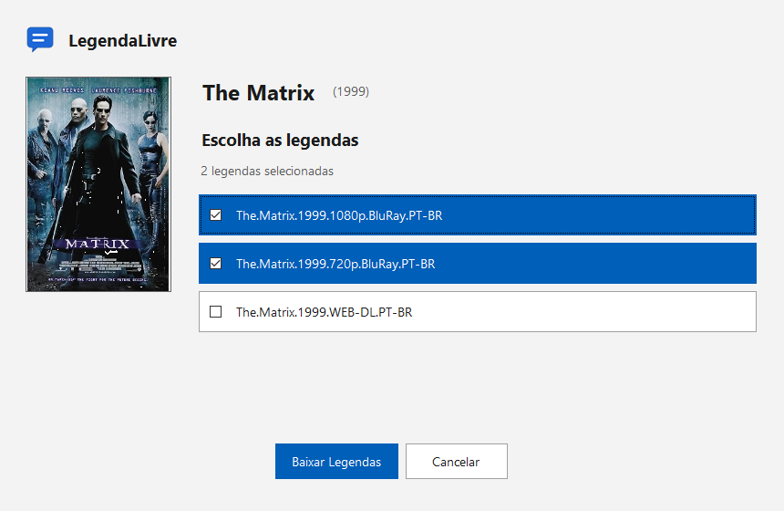
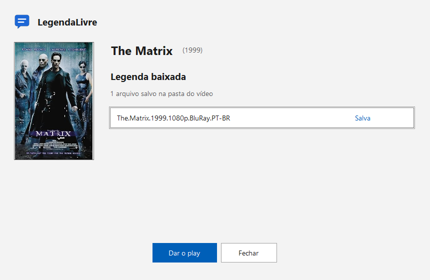

<div align="center">


<h1>LegendaLivre</h1>

<p><strong>Menos tempo procurando legendas. Mais tempo assistindo.</strong></p>

<p>Encontre e baixe legendas com apenas um clique. Gratuito e de código aberto.</p>

<p>
<a href="https://github.com/pabloviniciustbbt/LegendaLivre/releases/latest/download/LegendaLivre.exe"></a>
</p>

<p>
<a href="#por-que-o-legendalivre-existe">Por que existe</a> ·
<a href="#recursos">Recursos</a> ·
<a href="#instalação">Instalação</a> ·
<a href="#como-usar">Como usar</a> ·
<a href="#privacidade">Privacidade</a> ·
<a href="#contribuir">Contribuir</a>
</p>

<picture>
  <source media="(prefers-color-scheme: dark)" srcset="docs/imagens/tela-escuro.png">
  
</picture>

</div>

## Por que o LegendaLivre existe?

Durante anos, usei o Legendas Brasil para baixar legendas. Era simples e funcionava: bastava clicar com o botão direito em um arquivo de vídeo para encontrar a legenda. Nunca tive motivos para questionar o que estava sendo instalado no meu computador.

Até que resolvi analisar o instalador.

Encontrei componentes com comportamentos que não deveriam fazer parte de um baixador de legendas: monitoramento da navegação, interferência em páginas de compras e alterações nas configurações do antivírus. Tudo isso estava rodando no meu computador havia anos, sem meu conhecimento.

Para ter uma ideia do problema, na análise que consultei, **45 dos 71 mecanismos de segurança do [VirusTotal](https://www.virustotal.com/gui/file/8a349684f276a1cd35cd5948518447eddb310cea1740b3f151b7acb63df31364) sinalizaram o instalador como potencialmente malicioso.**

Eu só queria uma ferramenta simples para baixar legendas, sem precisar me preocupar com o que ela fazia em segundo plano.

Foi assim que surgiu o **LegendaLivre**.

O objetivo é manter a mesma praticidade: clicar com o botão direito no vídeo e baixar a legenda automaticamente, sem componentes ocultos ou modificações desnecessárias no sistema.

O projeto é gratuito e de código aberto. Qualquer pessoa pode inspecionar o código, entender como funciona, contribuir ou compilar sua própria versão.

**A ideia é simples: um baixador de legendas deve apenas baixar legendas.**

> **Já utilizou o Legendas Brasil?**
>
> A desinstalação pode não remover todos os componentes adicionados ao sistema. Confira o [guia de remoção](#guia-de-remoção-do-legendas-brasil) para verificar e limpar possíveis arquivos e configurações remanescentes.

## Recursos

- **Download em um clique:** baixe automaticamente a melhor legenda disponível para seu filme ou série.
- **Escolha sua legenda:** explore as 10 melhores opções e selecione as que deseja baixar.
- **Múltiplos idiomas:** suporte a Português (Brasil), Português (Portugal) e Inglês.
- **Vários vídeos de uma vez:** baixe legendas para múltiplos arquivos em uma única operação.
- **Legendas com acentuação correta:** arquivos salvos em UTF-8 para melhor compatibilidade.
- **Integração com o Windows:** acesso direto pelo menu do botão direito do Windows Explorer.

## Instalação

O LegendaLivre é compatível com Windows 10 e Windows 11.

1. Baixe o `LegendaLivre.exe` na página de [Releases](https://github.com/pabloviniciustbbt/LegendaLivre/releases/latest).
2. Execute o arquivo e siga as instruções na tela.
3. Pronto! O LegendaLivre estará disponível no menu do botão direito dos seus vídeos.

A instalação é feita no seu perfil do Windows, sem precisar de permissões de administrador.

**Para atualizar:** basta executar a versão mais recente.

> **Aviso do Windows:** o executável não tem assinatura digital paga. O SmartScreen avalia a reputação do arquivo e ainda não conhece esta versão, então o Windows pode mostrar **"O Windows protegeu o computador"**. Clique em **Mais informações** e depois em **Executar assim mesmo**.

<details>
<summary>Conferir o SHA256</summary>

Compare o resultado com o arquivo `LegendaLivre.exe.sha256` da mesma release:

```powershell
Get-FileHash .\LegendaLivre.exe -Algorithm SHA256
```

</details>

## Como usar

1. Clique com o botão direito no vídeo desejado.
2. Selecione **LegendaLivre** e escolha o idioma.
3. Escolha uma das opções disponíveis:

   - **Melhor legenda:** baixa automaticamente a legenda recomendada.
   - **Top 10:** permite visualizar e escolher entre até 10 legendas.

A legenda será salva automaticamente na mesma pasta do vídeo, com o nome correspondente.

<div align="center">

<picture>
  <source media="(prefers-color-scheme: dark)" srcset="docs/imagens/resultado-escuro.png">
  
</picture>

</div>

## Privacidade

O LegendaLivre foi desenvolvido para fazer apenas o necessário: encontrar e baixar legendas.

Para realizar as buscas, o programa envia ao servidor de legendas um identificador calculado a partir do vídeo e o idioma selecionado. No download, também são enviados os identificadores necessários para obter a legenda escolhida.

O LegendaLivre não coleta estatísticas de uso, não monitora sua navegação e não executa serviços em segundo plano.

Todo o código-fonte está disponível para consulta, permitindo que qualquer pessoa verifique como o programa funciona.

## Para desenvolvedores

Quer entender como o LegendaLivre funciona ou ajudar a desenvolver novas funcionalidades?

Todo o código-fonte está disponível neste repositório.

Você pode estudar a implementação, compilar sua própria versão, executar os testes e enviar contribuições.

O projeto está aberto a melhorias, correções e novas ideias.

<details>
<summary>Compilar e testar</summary>

Precisa de Windows, SDK do .NET 8 ou mais novo e PowerShell.

```bash
dotnet test tests/LegendaLivre.Testes -c Release
dotnet build src/LegendaLivre -c Release
```

O build compila os três módulos nativos antes do aplicativo. O executável fica em `src/LegendaLivre/bin/Release/net48/LegendaLivre.exe`.

Na primeira compilação, o build baixa o LLVM-MinGW 20261006, confere o SHA256 e guarda em `_scratch/compilador-nativo` (precisa de internet). Para usar um LLVM-MinGW já instalado, defina `LEGENDALIVRE_LLVM_MINGW` com o caminho da pasta `bin`.

Para validar os menus reais em processo isolado (hierarquia, nomes acessíveis, argumentos, seleções inválidas, borda, margem e 50 ciclos de abertura e fechamento em x64 e x86):

```powershell
powershell -File scripts/validar-menu.ps1
```

As evidências ficam em `_scratch/validacao-menu-nativo`, fora do Git.

</details>

<details>
<summary>Como funciona</summary>

- **Impressão digital:** hash de 64 bits (tamanho do arquivo mais a soma, em inteiros de 8 bytes, dos primeiros e últimos 64 KB; arquivos menores que 64 KB somam só a cabeça).
- **Protocolo:** busca e download pela fonte pública `getsubtitle.com`, via HTTPS e POST. Hash, identificadores e datas usam Base64. As listas chegam em XML.
- **Seleção:** Melhor legenda usa a seleção automática do servidor. Top 10 mantém a ordem devolvida pela fonte, até dez.
- **Executável único:** um só `.exe` .NET Framework 4.8.
- **Módulo nativo:** o executável incorpora um módulo C++ para x86, x64 e ARM64. A instalação extrai só a arquitetura do Windows. O módulo cria o menu dentro do Explorer. Busca e download ficam no aplicativo, sem carregar .NET no Explorer.
- **Fila:** o Explorer abre um processo por vídeo. O primeiro vira o principal e os outros entregam o caminho a ele por named pipe.
- **Log:** `%LOCALAPPDATA%\LegendaLivre\log.txt`.

</details>

<details>
<summary>Estrutura do repositório</summary>

```
src/
  LegendaLivre/                 aplicativo C# (.NET Framework 4.8) e janelas em Ui/
  LegendaLivre.MenuExplorer/    módulo nativo C++ do menu do Explorer
tests/
  LegendaLivre.Testes/          testes automatizados em C#
  menu-explorer/                validação do menu nativo
scripts/                        compilação e validação do módulo nativo
.github/workflows/              CI (com job de release) e alarme da fonte
```

</details>

<details>
<summary>Publicar uma versão</summary>

Crie e envie uma tag que comece com `v`:

```bash
git tag v1.0.1
git push origin v1.0.1
```

O CI roda os testes, compila e publica uma release com `LegendaLivre.exe` e `LegendaLivre.exe.sha256`. Ele também falha se o executável passar de 300 KB.

O workflow `alarme-fonte.yml` roda toda segunda-feira e consulta a fonte de legendas nos três idiomas. Se a resposta mudar de formato ou a fonte responder com erro HTTP, abre uma issue chamada "Fonte de legendas mudou". Falhas de rede não abrem issue.

</details>

## Contribuir

O LegendaLivre é um projeto de código aberto e toda contribuição é bem-vinda.

Existem várias maneiras de ajudar:

- **Encontrou um problema?** Abra uma issue descrevendo o que aconteceu.
- **Tem uma sugestão?** Compartilhe sua ideia.
- **Quer contribuir com código?** Faça um fork e envie um pull request.

Para mudanças maiores, recomendamos abrir uma issue antes de começar, para discutirmos a melhor abordagem.

Mesmo pequenas contribuições ajudam a melhorar o projeto.

<details>
<summary>Padrões do projeto</summary>

Para mudar o código:

1. Abra uma issue antes de mudanças grandes.
2. Faça um fork e crie um branch.
3. Rode `dotnet test tests/LegendaLivre.Testes -c Release`.
4. Abra o pull request com uma mudança lógica por commit.

Regras do projeto:

- Commits em Conventional Commits, em PT-BR: `tipo(escopo): descrição`, minúsculo, imperativo, sem ponto final. Exemplo: `fix(salvamento): preserve arquivos temporários`.
- Tipos: `feat`, `fix`, `docs`, `test`, `style`, `chore`, `refactor`, `perf`, `revert`.
- Código e nomes em PT-BR.
- No máximo 350 linhas por arquivo (testes e declarações de tipos ficam de fora).
- Sem log solto: mensagens, avisos e erros passam por `Log`.
- Interface não acessa dados diretamente; use os serviços.

</details>

## Guia de remoção do Legendas Brasil

A desinstalação do Legendas Brasil pode deixar componentes adicionais no Windows, incluindo serviços, drivers, certificados e alterações nas configurações de segurança.

Este guia apresenta os procedimentos para identificar e remover esses componentes com segurança.

> **Importante:** as informações foram levantadas a partir da versão 3.83 do programa. Outras versões podem apresentar diferenças.

Siga as etapas em ordem e remova somente os componentes identificados.

A versão 3.83 instala:

- o driver de rede `legendasdrv.sys`, que intercepta tráfego HTTP e HTTPS;
- o serviço `ComLegService` (`srvlegendas.exe`);
- o certificado raiz `ComLegService Root CA 2` (thumbprint `E2989A8E6ED8C4698466D47ACAB4FBAA50F017C2`), no repositório do Windows e no Firefox;
- uma exclusão no Microsoft Defender para `C:\Program Files (x86)\LegendasBrasil\Legendas`.

1. **Desinstale o programa.** Abra Configurações do Windows, **Aplicativos**, **Legendas Brasil**, **Desinstalar**.

2. **Confira o serviço e o driver.** Rode no PowerShell (administrador não é necessário):

   ```powershell
   sc.exe query ComLegService
   sc.exe query legendasdrv
   ```

   Os dois comandos devem informar que o serviço não existe. Se algum aparecer como instalado, pare e apague no PowerShell **como administrador** e reinicie o computador:

   ```powershell
   sc.exe stop ComLegService; sc.exe delete ComLegService
   sc.exe stop legendasdrv; sc.exe delete legendasdrv
   ```

3. **Remova o certificado do Windows.** Pela interface: abra `certlm.msc`, vá em **Autoridades de Certificação Raiz Confiáveis**, **Certificados**, selecione `ComLegService Root CA 2` e clique em **Excluir**.

   Ou pelo PowerShell **como administrador**:

   ```powershell
   Get-ChildItem Cert:\LocalMachine\Root | Where-Object Thumbprint -eq 'E2989A8E6ED8C4698466D47ACAB4FBAA50F017C2' | Remove-Item
   ```

   Confira também o repositório do usuário. Este comando não exige administrador:

   ```powershell
   Get-ChildItem Cert:\CurrentUser\Root | Where-Object Thumbprint -eq 'E2989A8E6ED8C4698466D47ACAB4FBAA50F017C2' | Remove-Item
   ```

4. **Remova o certificado do Firefox.** O Firefox usa repositório próprio. Abra **Configurações**, **Privacidade e Segurança**, **Certificados**, **Ver certificados**, aba **Autoridades**, selecione `ComLegService Root CA 2` e exclua.

5. **Remova a exclusão do Defender.** No PowerShell **como administrador**, liste as exclusões:

   ```powershell
   Get-MpPreference | Select-Object -ExpandProperty ExclusionPath
   ```

   Se `C:\Program Files (x86)\LegendasBrasil\Legendas` aparecer, remova:

   ```powershell
   Remove-MpPreference -ExclusionPath 'C:\Program Files (x86)\LegendasBrasil\Legendas'
   ```

   Pela interface: Segurança do Windows, **Proteção contra vírus e ameaças**, **Gerenciar configurações**, **Exclusões**.

6. **Troque as senhas importantes.** Com o certificado instalado, o tráfego HTTPS podia ser lido. Troque as senhas de e-mail, banco e demais contas sensíveis.

## Aviso

Projeto independente, sem vínculo com os serviços de legendas e de catálogo que usa. As legendas pertencem aos seus autores.

As informações sobre o Legendas Brasil se referem ao instalador `Legendas383.exe` analisado (SHA-256 `8a349684f276a1cd35cd5948518447eddb310cea1740b3f151b7acb63df31364`) e às detecções públicas do VirusTotal. Outras versões podem ser diferentes.

## Licença

O LegendaLivre é um projeto de código aberto, disponibilizado sob a [licença MIT](LICENSE).

Criado e mantido por [Pablo Leal](https://github.com/pabloviniciustbbt).
